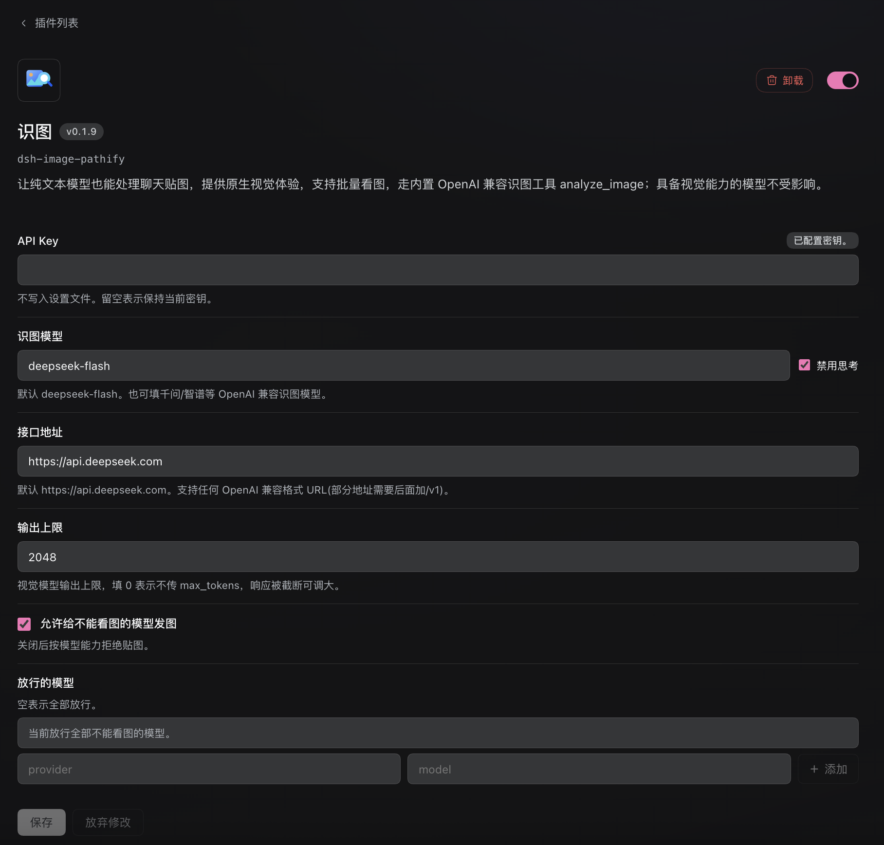
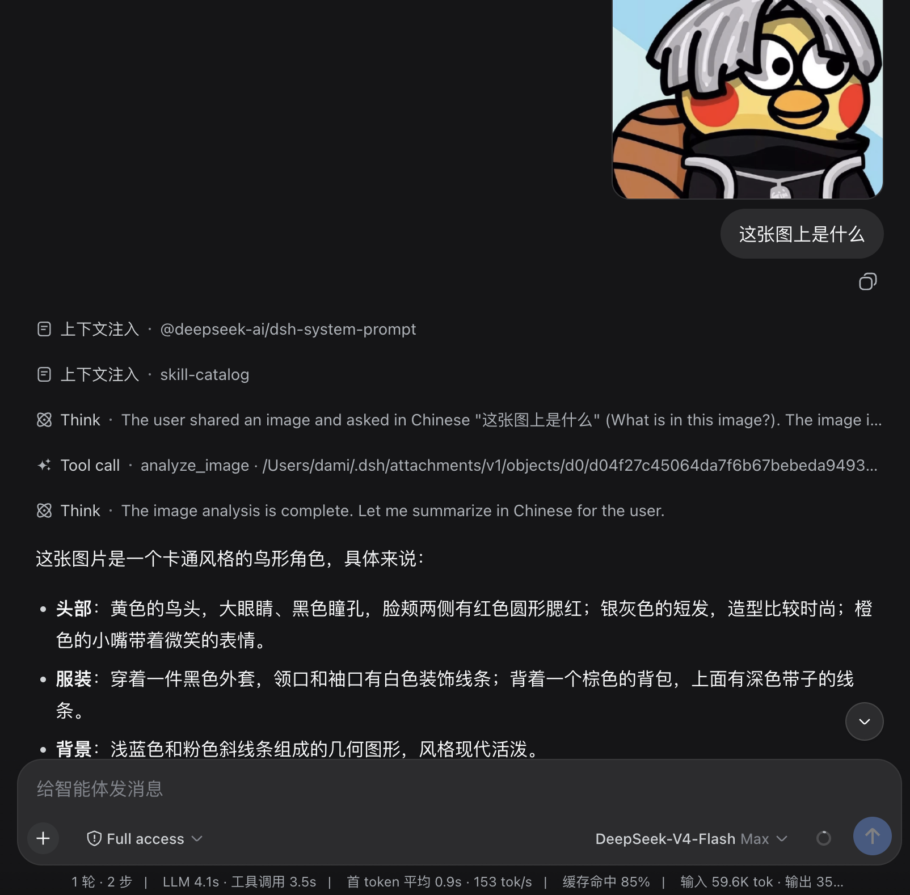

# dsh-image-pathify

> 0.2.3 兼容 DeepSeek Harness **0.1.7-rc.1 ~ 0.2.2-rc.1**，已在 **0.2.2-rc.1** 实测（同时保留 0.2.1-rc.2 及更早版本的兼容路径）。dsh 0.1.5 及以下请继续使用 `dsh-image-pathify@0.1.9`。

让 **deepseek-v4** 这类「不能看图」的模型，也能处理你贴进聊天里的图片，并直接调用插件内置的识图工具。

聊天记录和界面里的缩略图**不会变**。插件只在把消息发给模型前，把图片换成一行本地文件路径；模型再调用 `analyze_image` 读这个文件，通过你配置的视觉 API 得到文字描述。

```
你贴一张图  →  聊天里照常显示缩略图
           ↓
发给不能看图的模型前  →  变成：Saved attachments: /某路径/某文件
           ↓
模型调用 analyze_image  →  视觉 API 返回文字描述（多张图一次请求、同一次看见全部）
```

已经能看图的模型不受影响：图片会原样发给它们，`analyze_image` 不会出现在它们的工具列表和系统提示里。`read_image` 在不能看图的模型上会被拒绝，并提示改用 `analyze_image`。

磁盘上的图片文件是 **dsh 自己保存的附件**（`~/.dsh/attachments/v1/...`），不是本插件另存的一份。

## 安装

```sh
dsh plugin --profile web add dsh-image-pathify
dsh web
```

打开 **插件 → 识图** 进详情页可配置（插件旧版 0.1.x 在 设置 → 插件 → 识图），填写后点保存：

- API 密钥（写入 `$DSH_HOME/.credentials.yaml`，不进设置文件）
- 识图模型（默认 `deepseek-flash`）
- 识图 API 地址（默认 `https://api.deepseek.com`）
- **禁用思考**（默认勾选）。DeepSeek 识图模型（如 `deepseek-flash`）默认会思考，思考 token 计入输出上限；取消勾选才会走思考模式，开启思考时应增大输出上限

任何 OpenAI 兼容的视觉接口都可以，把地址(部分地址需要后面加/v1)和模型改成你的服务即可。设置页改动保存后立即生效，不用重启。



> 截图为旧版 0.1.9 的设置页；0.2.x 的入口是顶部 **插件 → 识图**，字段相同。

## 怎么确认可用

1. 插件页里打开 **识图**，详情上方出现识图设置
2. 给不能看图的模型发一张图：界面里缩略图还在；模型调用 `analyze_image` 而不是 `read_image`
3. 给不能看图的模型发本地图片路径或图片URL：应直接调用 `analyze_image`，不会先 `read_image`
4. 给能看图的模型发一张图：模型直接回答，不调用 `analyze_image`
5. 给能看图的模型发本地图片路径或图片URL：应直接调用 `read_image`，不会先 `analyze_image`



## 配置

插件页保存后立即生效。识图字段写在该插件的 Loader 配置里，也就是 `$DSH_HOME/profiles/name/cordis.patch.yml`（0.1.x 写在 `settings.yaml` 的 `image-pathify` 段，**不会**自动导入，需要在插件页重新填写）；API 密钥仍写在 `$DSH_HOME/.credentials.yaml`。

| 选项              | 默认                       | 做什么                                                                                                                                               |
| ----------------- | -------------------------- | ---------------------------------------------------------------------------------------------------------------------------------------------------- |
| `apiKeyEnv`       | `IMAGE_PATHIFY_API_KEY`    | 凭据引用名。密钥本身写在 `$DSH_HOME/.credentials.yaml`，不进设置文件                                                                                 |
| `visionModel`     | `deepseek-flash`           | 识图模型 id。                                                                                                                                        |
| `visionBaseUrl`   | `https://api.deepseek.com` | OpenAI 兼容基址。(部分地址需要后面加/v1)                                                                                                             |
| `disableThinking` | `true`                     | 默认勾选。仅 DeepSeek 等支持 `thinking` 的接口会带上该字段，如果需要思考和详细输出请取消勾选，并增大输出上限，防止输出内容被截断(思考也会占用tokens) |
| `maxTokens`       | `2048`                     | 输出上限。`0` = 不传 `max_tokens`(不传时各家默认值处理方式并不统一)                                                                                  |
| `models`          | 空 = 全部不能看图的模型    | 只决定**哪些模型允许发图**。空 = 都能发。填了就只放行名单里的模型                                                                                    |
| `relaxAdmission`  | `true`                     | 允许给不能看图的模型发图。关闭后按模型能力拒绝贴图                                                                                                   |

`apiKeyEnv` 未配置时默认指向 `IMAGE_PATHIFY_API_KEY`, 将 API Key 指向官方环境变量的例子：

```yaml
- id: dsh-image-pathify
  name: dsh-image-pathify
  config:
    visionModel: deepseek-flash
    visionBaseUrl: https://api.deepseek.com
    apiKeyEnv: DEEPSEEK_API_KEY
  disabled: false
```

只允许 deepseek-v4 发图的例子：

```yaml
- id: dsh-image-pathify
  name: dsh-image-pathify
  config:
    models:
      - provider: deepseek-official
        model: deepseek-v4-flash
      - provider: deepseek-official
        model: deepseek-v4-pro
```

用千问 DashScope 识图：

```yaml
- id: dsh-image-pathify
  name: dsh-image-pathify
  config:
    visionModel: qwen-vl-plus
    visionBaseUrl: https://dashscope.aliyuncs.com/compatible-mode/v1
```

模型侧只多一个工具 `analyze_image`（仅不能看图的模型能看见、能调用，防止与具备识图能力的模型冲突）。

- 一张图：`image` 填本地路径、`file://` URL 或 `http(s)` 图片 URL（不要带路径前缀）
- 本地相对路径按当前会话工作目录解析；没有会话工作目录时按 dsh 进程目录解析
- 多张图：用 `images` 一次传入全部路径，插件会在**同一次**视觉请求里带上所有图片，不必一张一张等
- `prompt` 可选

同一轮里有多张图时，系统提示会要求模型把所有路径放进一次 `analyze_image` 调用，而不是循环调用。

PTC 模式下模型只能直接调用 `run_code`，此时 `analyze_image` 在 `run_code` 的 SDK 里调用；插件提示词已经包含这条说明。

## 开发与构建

```sh
pnpm install
pnpm check
```

`pnpm check` 会按顺序执行 `typecheck`、`test`、`build`。

### dsh 0.2.2 的提示词组装变化

0.2.2 把 `system-prompt/assemble` 瀑布流的参数拆成了 `PromptPresentation`（只有 `sections` / `contexts` / `variables`），工具声明改成瀑布流结束之后由宿主拼回，监听器既读不到也改不了。旧版插件在监听器里调用 `assembly.tools.filter(...)`，会在会话的第二次请求开始抛 `Cannot read properties of undefined (reading 'filter')`，整轮失败。

现在插件按版本分层：

- 组装阶段只裁剪 `sections`（视觉提示词段落），路由优先取 `context.modelSelection`（0.2.2 新增，第一步就精确），取不到才回退到最后一次请求头；
- 工具可见性全部交给 `llm/stream` 的 `filterDispatchForRoute`，它同时处理 `options.tools` 和 `toolHistory`，0.2.2 下仍然有效；
- `PromptAssemblyLike.tools` 为可选，0.2.1 及更早版本传入 tools 时行为不变。

`tests/host-assemble.spec.ts` 直接驱动宿主真实的 `SystemPrompt.assemble()`，回归这条契约。

## License

MIT
